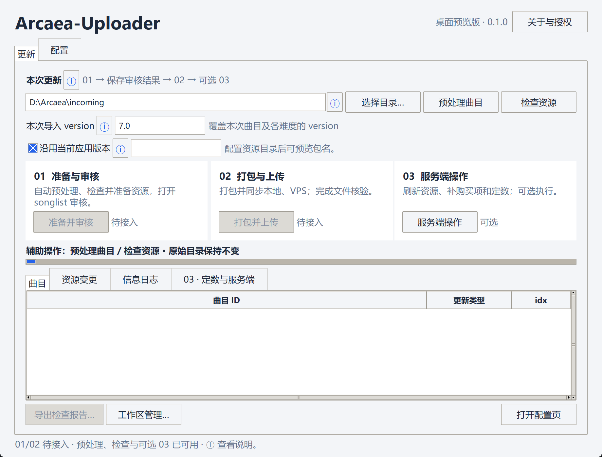

# Arcaea-Uploader

[](https://github.com/starskyer/Arcaea-Uploader/actions/workflows/ci.yml)

面向 **Lost-MSth** 的 [Arcaea-server](https://github.com/Lost-MSth/Arcaea-server) 的桌面资源更新助手。把待更新曲目放入一个输入目录，通过紧凑窗口整理格式、检查增量资源并审核报告。目标工作流为「准备本地资源并人工审核 songlist → 打包、上传服务端并刷新资源」。

**当前已实现桌面窗口、曲目预处理、配置保存/载入、后台资源预检和报告导出。** “准备并审核”“发布更新”按钮尚未接入完整执行逻辑，界面中禁用并标注待接入。预处理只生成工作副本，原始曲目包、active 和服务端保持不变；资源预检仍为只读。

Bundler 核心和图片/预览处理现已内置，无需另行下载 Bundler 或配置脚本路径。打包及媒体模块已单独验证，尚未接入上述两阶段按钮。



## 打开桌面窗口

Windows 用户可从 [Releases](https://github.com/starskyer/Arcaea-Uploader/releases) 下载便携版 ZIP，完整解压后运行 `Arcaea-Uploader.exe`，无需安装 Python；保留同目录的 `_internal` 文件夹。FFmpeg 仍需自行安装或在配置页指定。当前为预览版，具体限制见发布说明。

从源码运行时，需要 Python 3.10+（含 Tkinter），在项目目录安装依赖一次：

```powershell
python -m pip install -e .
```

Windows 已关联 Python `.pyw` 时，双击项目中的 `Arcaea-Uploader.pyw` 即可打开窗口，不显示控制台；也可使用安装后的 `arcaea-uploader-gui` 入口，或执行 `python -m arcaea_uploader`。

- **更新页**：选择收集曲目的来源目录，填写“本次导入 version”，点击“预处理曲目”整理嵌套、songlist/slst、曲绘、音频和空谱；随后“检查资源”检查本次标准副本。滚动日志按 INFO / WARNING / ERROR 显示，结果可导出 JSON 报告。
- **配置页**：填写本地 Arcaea-server、active、曲目输入目录、发布工作区；填写 SSH 主机、端口、用户名、服务器项目路径、密钥及刷新 API 设置。路径可浏览选择，配置在同一页滚动查看。FFmpeg 仍为外部程序，可指定路径，或留空从 PATH 查找。
- 点击“保存配置”后，下次打开会恢复设置；也可载入已有 JSON 配置或另存。曲目目录和导入 version 在两页同步；“背景对应表…”可查看、编辑或重新读取 active 总表中的翻转关系。
- “沿用当前应用版本”默认勾选，输入框锁定并显示从 Bundler 历史识别的应用版本；取消后填写新应用版本，窗口预览 `.0` 承接包名称。该设置保存在 `bundle` 配置组，与曲目导入 version 分开。

开发目录存在被忽略的 `config.local.json` 时优先使用；否则默认配置保存于用户本地应用数据目录的 `Arcaea-Uploader/config.json`。可用 `python -m arcaea_uploader gui --config <路径>` 明确指定。配置页允许先保存不完整的信息；资源预检时再校验本地路径，不要求提供 VPS 凭据。详见[桌面界面说明](docs/desktop.md)。

## 收集曲目预处理

支持嵌套目录、目录名与 ID 不一致、slst 别名、可恢复的单曲 JSON、单张曲绘补缩略图、MP3/WAV 主音频转 OGG、忽略 Arcade 工程和排除默认空 AFF。标准 ID 采用 songlist.id，只有工作副本改名并报告 INFO；缺失、空或不合法的 ID 报 ERROR，不从目录名推断。空谱按内容判断，短谱不会仅因体积小而被排除；已声明但没有实际谱面的难度保留，rating 统一为 0。

已有总表可按精确 ID 补全缺失信息；新曲目描述缺失、同 ID 多来源或资源冲突会列为待处理，不凭空生成作者、定级和预览时间。详见[预处理规则](docs/preprocessing.md)。

本次导入 version 必填，强制覆盖本批曲目及其声明难度的 version，包括原始未填写的情况；同时设置 `remote_dl: true`。这个值用于 songlist；bundle 应用版本单独设置，命名规则见下文。背景对应表首次从 active 的 `songs/songlist` 初始化，按无向关系一一配对；配置中只写一次 `"A": "B"`，即可从任意一边查到另一边。未明确填写 `bg_inverse` 时优先查表，再尝试 `_light` / `_conflict` 后缀规则，有歧义则 WARNING 提醒人工确认。

[config.example.json](config.example.json) 已包含当前确认的全部 **36 组背景配对**，可直接查看、载入并按自己的资源调整；不包含背景图片。其本地路径、服务器地址均为示例。

额外 WAV 特殊音效不进入 bundle 或服务端下载资源，报告 WARNING，谱面引用保留供人工处理。**后缀正确但实际编码不同的文件，当前不做专门识别、修复或提示，按原始字节继续导入。** 常规尺寸调整、缩略图生成和预览处理仍按规则执行；图片派生保留源图实际编码，不主动纠正后缀。

INFO 表示可自动处理且无需人工检查；WARNING 表示可继续处理但需人工知悉或审核；ERROR 表示无法自动决定。扫描会收集其他曲目的问题，任一 ERROR 都会令本批次无效；WARNING 本身不阻断预检。

## 目标：两步发布

1. **准备并审核（第一步按钮，待实现）**：扫描所有输入曲目，增量准备服务端下载文件及 bundle 曲绘、背景和预览，自动合并总 songlist、输出冲突报告；准备结束后用记事本打开 songlist，交由人工检查和保存。
2. **发布更新（第二步按钮，待实现）**：读取已保存的 songlist，校验引用和资源；如预览时间被改动则重建预览；调用 Bundler，先完成本地 database，再通过 SSH 上传同一批 bundle 与下载资源，最后刷新运行中的服务端。

songlist 冲突保留原值并报告，供审核时修改；未知背景尺寸阻止该批次发布。完整阶段边界见[两步更新流程](docs/update-workflow.md)。

bundle 采用两种命名规则，内置适配层已实现，发布按钮仍待接入：

| 模式 | JSON 版本 | 文件名前缀 |
| --- | --- | --- |
| 默认沿用当前应用版本 | 保留历史中的 `applicationVersionNumber`，递增 `versionNumber` | 本次 `versionNumber`，如 `7.0.256.5` |
| 手动切换应用版本 / 首次构建 | `applicationVersionNumber` 和 `versionNumber` 都使用新应用版本 | 新应用版本加 `.0`，如 `7.0.257.0` |

每包生成同前缀 `.cb` 与 `.json`。承接包保留上一包的 `previousVersionNumber`；之后沿用新应用版本继续生成 `.1`、`.2`。配置中的 `bundle.follow_app_version` 默认为 `true`，取消勾选后使用 `bundle.app_version`。首次构建没有历史，需手动填写应用版本；已与当前相同的手动版本提示改用沿用模式。校验成功后产物才就位，同名目标已存在则拒绝覆盖。

## 曲目如何分流

输入目录的每个直接子目录就是一个原始曲目 ID，例如 `incoming/example/`。完整新曲目一般包含数字 `.aff`、`base.ogg`、`base.jpg`、`base_256.jpg` 和 songlist；已有曲目允许只提交新增文件及 songlist 补丁。

| 输入内容 | bundle 资源包侧 | 服务端 `latest version/database` 侧 |
| --- | --- | --- |
| 曲目 songlist | 合并至 `songs/songlist`，新曲目 `idx = max(idx) + 1` | 当前不自动写入 `songs/songlist` |
| 曲绘 JPG | `songs/dl_<id>/`，随后规范化名称与尺寸 | 不保留 |
| 自定义背景 JPG | 1920×1440 → `img/bg/1080/`；1440×1080、1280×960 → `img/bg/` | 不保留 |
| `base.ogg`、`0–4.ogg` | 准备预览；独立音频的兼容规则待补充 | `songs/<id>/` 保留完整音频 |
| `0–4.aff` | 不保留 | `songs/<id>/`；只对实际缺失的 `0–2.aff` 补占位 |
| `video_1080.mp4` | 不保留 | `songs/<id>/` 原样保留 |

增量更新保留已有文件及未提交的字段、难度，不以原始目录替换整个目标目录。详细输入约定与例子见[曲目资源规则](docs/song-packages.md)。

背景导入前先检查 `img/bg` 与 `img/bg/1080` 两处全部文件；完整文件名已存在则跳过并报告 INFO，再对未重名的新背景按尺寸分流。1920×1200 等新尺寸报 ERROR。songlist 引用的背景若既不在已有目录，也不由本批次引入，则报 WARNING。

## 可选命令行预检

需要 Python 3.10+。在本项目目录执行：

```powershell
python -m pip install -e .
Copy-Item config.example.json config.local.json
# 修改 config.local.json 中的 local 路径及 import.version
python -m arcaea_uploader plan --config config.local.json > plan.local.json
```

`plan` 当前使用 `local.input_root`、`assets_root`、`server_project_root`、`database_relative_path`、`placeholder_aff` 及 `import` 规则。相对路径以配置文件所在目录为基准。FFmpeg、SSH 和 API 字段为后续执行阶段预留，预检不连接 VPS，也不要求配置凭据。旧配置中的 `bundler_entry`、`bundler_root`、`media_script` 在载入时忽略，保存时移除，其余配置保留。

报告包含 songlist 合并草案、字段冲突、资源去向、下载文件哈希差异、占位谱面和预览任务。图片/音频条目标为 `prepare_media`，尚未转换，不能视为最终上传差异。缺失或冲突会报告，`publishable` 始终为 `false`，必须经过后续人工审核和执行阶段。

退出码：`0` 表示无阻断错误（仍可能有 WARNING），`1` 表示存在资源等 ERROR，`2` 表示配置或总 songlist 无效。songlist 字段冲突保留原值并报告 WARNING，由人工审核。预检不执行自动覆盖。

## 集成工具

- [Arcaea-Bundler](https://github.com/Lost-MSth/Arcaea-Bundler)：生成 `.cb` 与配套 `.json`，维护 `metadata.oldjson` 增量历史。MIT 许可，内置与现有本地副本完全相同的固定版本，保留作者 Lost-MSth 的版权声明和完整许可证。
- [Arcaea-server](https://github.com/Lost-MSth/Arcaea-server)：下载资源目录、bundle 版本索引及刷新管理 API。
- 内置媒体模块：由维护者提供的 `resize_and_preview.py` 整理而来，保留原始快照，修复缩略图漏改名、预览重建和难度查找问题；完整源音频由调用方保留。
- SSH / SFTP：后续只通过 SSH 连接 VPS，端口默认 `22`；服务器项目根路径可指定。

行为依据本地副本核对，详见[工具调查](docs/existing-tools.md)。运行验证：

```powershell
python -m unittest discover -s tests -v
```

FFmpeg 在 PATH 中时会运行真实音频集成测试；也可设置 `ARCAEA_UPLOADER_TEST_FFMPEG` 指定测试用可执行文件。没有 FFmpeg 时仅跳过该集成测试。

## 第三方授权

内置 Bundler 的原作者为 **Lost-MSth**，许可证为 **MIT**，原 `main.py` 未修改。来源提交、文件校验和、适配边界及分发时保留许可证的方式见[组件整合说明](docs/integrated-tools.md)和[第三方声明](THIRD_PARTY_NOTICES.md)。窗口右上角“关于与授权”可以查看完整 Bundler 许可证。

本项目自有代码采用 [MIT 许可证](LICENSE)，Copyright (c) 2026 StarSkyer。Bundler 保留 Lost-MSth 的原始 MIT 许可证与版权声明。Python 安装包包含这些许可文件；Windows 便携包同时带有 `licenses/` 和 `THIRD_PARTY_LICENSES.json`，保留实际随包 Python、Tcl/Tk、Pillow 等组件的许可证。

## 公开仓库范围

仓库保存 Uploader 代码、文档与脱敏配置示例。原始曲目、assets、生成的工作区、服务端数据库和凭据不进入仓库。第三方代码保持其原始许可与版权声明。

问题与建议通过 [Issues](https://github.com/starskyer/Arcaea-Uploader/issues) 提交；开发环境、贡献与版本发布分别见 [CONTRIBUTING](CONTRIBUTING.md)、[发布维护说明](docs/releasing.md)、[更新记录](CHANGELOG.md)。安全问题见 [SECURITY](SECURITY.md)。
